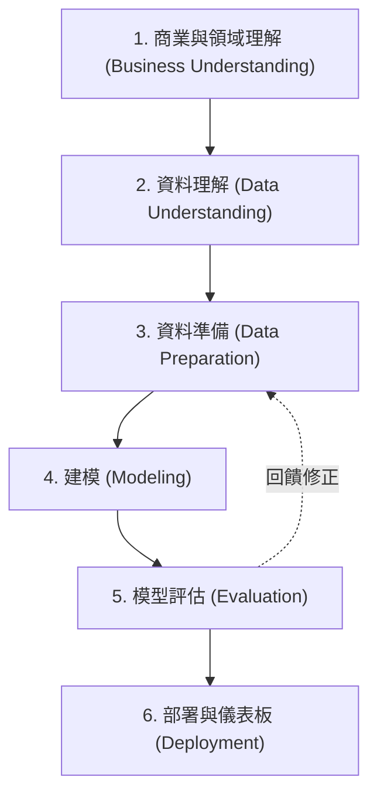

# 🍷 WINE_QUALITY.EXE | ML Feature Selection Lab (CRISP-DM)

本專案以 **CRISP-DM（Cross-Industry Standard Process for Data Mining）** 資料探勘流程為核心框架，針對 UCI 經典 **葡萄酒品質資料集（Wine Quality Dataset）**，分別對 **紅葡萄酒（Red Wine，1,599 筆）** 與 **白葡萄酒（White Wine，4,898 筆）** 進行深度多元線性迴歸（Multiple Linear Regression, OLS）與 **5 種特徵選取（Feature Selection）演算法** 的完整比較研究。

專案包含完整的 Python 數據管線、特徵遞進分析（k = 1 ~ 11）、高解析度圖表輸出，以及一套基於 **Y2K / 90 年代 Windows 95 Cyber-Studio** 風格打造的高互動式網頁儀表板（`index.html`）。

---

## 📑 目錄

- [專案簡介與目標](#-專案簡介與目標)
- [CRISP-DM 六大分析階段](#-crisp-dm-六大分析階段)
- [特徵選取演算法與比較](#-特徵選取演算法與比較)
- [實驗成果與關鍵發現](#-實驗成果與關鍵發現)
- [專案目錄架構](#-專案目錄架構)
- [環境需求與安裝](#-環境需求與安裝)
- [快速執行指南](#-快速執行指南)
- [互動式網頁儀表板功能亮點](#-互動式網頁儀表板功能亮點)
- [引用與參考資料](#-引用與參考資料)

---

## 🎯 專案簡介與目標

葡萄酒的感官評分（Quality Score，範圍 0~10 分）通常由專業品酒師盲測評定，評分過程耗時且具主觀性。本研究透過 11 種客觀理化特徵（Physicochemical Properties），探討：
1. **能否以最少且最關鍵的化學特徵**，建立預測精度最高、泛化能力最強的線性迴歸模型？
2. **紅酒與白酒的風味驅動因子有何本質差異？**
3. 比較不同特徵篩選策略（包裝法 Wrapper、嵌入法 Embedded、過濾法 Filter、窮舉法 Exhaustive）在不同樣本規模下的表現差異與過擬合（Overfitting）現象。

---

## 🔄 CRISP-DM 六大分析階段



### 1. 商業與領域理解 (Business Understanding)
- **預測標的**：葡萄酒品質評分（`quality`，整數 3 ~ 9 分）。
- **目標評估指標**：5-Fold 交叉驗證均方根誤差（CV RMSE）、測試集 RMSE、判定係數 ($R^2$) 與調整後判定係數（Adjusted $R^2$）。
- **業務約束**：模型需具備高度可解釋性（可作為酒莊釀造與調酒控制的化學指南）。

### 2. 資料理解 (Data Understanding)
資料集涵蓋 11 項理化指標變數：
- **酸度系統**：固定酸（`fixed acidity`）、揮發性酸（`volatile acidity`，如醋酸）、檸檬酸（`citric acid`）、酸鹼值（`pH`）。
- **糖與醇度**：殘糖量（`residual sugar`）、酒精度（`alcohol`）。
- **鹽類與二氧化硫**：氯化物（`chlorides`）、游離二氧化硫（`free sulfur dioxide`）、總二氧化硫（`total sulfur dioxide`）、硫酸鹽（`sulphates`）。
- **物理指標**：比重密度（`density`）。
- **統計診斷**：使用變異數膨脹因子（VIF）檢驗共線性，並計算 Studentized Residuals 檢測影響力最大的 Top 10 離群樣本。

### 3. 資料準備 (Data Preparation)
- **樣本切分**：80% 訓練集（Train Set）與 20% 獨立測試集（Test Set），設定固定亂數種子（`random_state=42`）。
- **特徵標準化**：採用 `StandardScaler` 進行 Z-Score 標準化，消除各變數尺度量綱差異。
- **交叉驗證**：在訓練集內建置 5-Fold KFold 交叉驗證機制。

### 4. 建模 (Modeling)
針對紅酒與白酒各別訓練 **多元線性迴歸（Ordinary Least Squares, OLS）**，並套用 5 種特徵選取演算法：
1. **Baseline OLS**：包含全部 11 個特徵的基準模型。
2. **LassoCV (L1 嵌入法)**：利用 L1 正則化進行稀疏特徵權重收縮。
3. **Sequential Forward Selection (SFS，前向包裝法)**：由空集合出發，依序納入對 CV 評分貢獻最大的特徵。
4. **RFECV (遞迴特徵消除法)**：由全特徵出發，結合 5-Fold CV 逐次剔除權重最小的特徵。
5. **ElasticNetCV (彈性網絡嵌入法)**：結合 L1 與 L2 正則化平衡特徵共線性。
6. **Exhaustive Feature Selection (窮舉搜尋法)**：暴力評估所有可能的特徵組合，找出全域最優解。

### 5. 評估與特徵演進 (Evaluation)
- **特徵數演進（Progression Analysis）**：系統性評估特徵數量從 $k = 1$ 至 $k = 11$ 的性能變化曲線。
- **甜蜜點（Sweet Spot）**：找出測試集 RMSE 最低、Adjusted $R^2$ 最高的「最佳性價比特徵組合」。
- **過擬合懸崖（Overfit Cliff）**：驗證當特徵數過多（如 $k=11$）時，模型複雜度提高而測試誤差反升的現象。

### 6. 部署 (Deployment)
- 輸出高解析度實驗圖表與 CSV 摘要報表。
- 提取全量數據序列化為 `wine_web_data.json`。
- 編譯生成單一無依賴的 **Windows 95 Cyber-Studio 互動網頁儀表板（`index.html`）**。

---

## 📊 實驗成果與關鍵發現

### 1. 紅酒模型評估對照表 (Red Wine, N = 1,599)

| 演算法 (Method) | 特徵數 ($k$) | 最佳選取特徵子集 | 5-Fold CV RMSE | Test RMSE | Test $R^2$ | Adjusted $R^2$ |
| :--- | :---: | :--- | :---: | :---: | :---: | :---: |
| **★ Forward SFS** | **6** | `volatile acidity`, `chlorides`, `total SO₂`, `pH`, `sulphates`, `alcohol` | **0.6582** | **0.6246** | **0.4031** | **0.3916** |
| **★ Exhaustive** | **6** | `volatile acidity`, `chlorides`, `total SO₂`, `pH`, `sulphates`, `alcohol` | **0.6582** | **0.6246** | **0.4031** | **0.3916** |
| **RFECV** | 7 | `volatile acidity`, `chlorides`, `free SO₂`, `total SO₂`, `pH`, `sulphates`, `alcohol` | 0.6587 | 0.6255 | 0.4013 | 0.3878 |
| **LassoCV** | 8 | `fixed acidity`, `volatile acidity`, `chlorides`, `free SO₂`, `total SO₂`, `pH`, `sulphates`, `alcohol` | 0.6596 | 0.6259 | 0.4006 | 0.3851 |
| **ElasticNetCV** | 8 | `fixed acidity`, `volatile acidity`, `chlorides`, `free SO₂`, `total SO₂`, `pH`, `sulphates`, `alcohol` | 0.6596 | 0.6259 | 0.4006 | 0.3851 |
| **Baseline OLS** | 11 | 全部 11 個化學特徵 | 0.6618 | 0.6245 | 0.4032 | 0.3819 |

> 💡 **紅酒關鍵發現**：
> - 僅需 **6 個特徵**（Forward SFS / Exhaustive）即可達到與 11 個特徵全模型相當的測試精度，且 **Adjusted $R^2$（0.3916）顯著高於全模型的 0.3819**。
> - **酒精度（Alcohol）** 是最強正向因子（$\beta \approx +0.286$）；**揮發性酸（Volatile Acidity）** 是最強負向因子（$\beta \approx -1.012$）。過高的揮發酸代表醋酸腐敗，直接重創品質評分。

---

### 2. 白酒模型評估對照表 (White Wine, N = 4,898)

| 演算法 (Method) | 特徵數 $k$ | 最佳選取特徵子集 | 5-Fold CV RMSE | Test RMSE | Test $R^2$ | Adjusted $R^2$ |
| :--- | :---: | :--- | :---: | :---: | :---: | :---: |
| **★ RFECV** | **7** | `volatile acidity`, `residual sugar`, `free SO₂`, `density`, `pH`, `sulphates`, `alcohol` | **0.7542** | **0.7563** | **0.2615** | **0.2562** |
| **★ Exhaustive** | **7** | `volatile acidity`, `residual sugar`, `free SO₂`, `density`, `pH`, `sulphates`, `alcohol` | **0.7542** | **0.7563** | **0.2615** | **0.2562** |
| **Forward SFS** | 8 | `fixed acidity`, `volatile acidity`, `residual sugar`, `free SO₂`, `density`, `pH`, `sulphates`, `alcohol` | 0.7553 | 0.7541 | 0.2658 | 0.2598 |
| **LassoCV** | 10 | 剔除 `fixed acidity` 以外的 10 個特徵 | 0.7548 | 0.7562 | 0.2617 | 0.2541 |
| **ElasticNetCV** | 11 | 全部 11 個化學特徵 | 0.7560 | 0.7543 | 0.2653 | 0.2569 |
| **Baseline OLS** | 11 | 全部 11 個化學特徵 | 0.7560 | 0.7543 | 0.2653 | 0.2569 |

> 💡 **白酒關鍵發現**：
> - 白酒評分對 **殘糖（Residual Sugar）** 與 **比重密度（Density）** 高度敏感。殘糖能平衡白酒的清脆酸感，密度則反應整體酒體萃取物多寡。
> - RFECV 在 7 個特徵時即收斂至最低交叉驗證誤差（0.7542）。

---

## 📁 專案目錄架構

```text
d:/AIoT_HW2/
│
├── README.md                                # 專案說明文件（本檔）
├── winequality-red.csv                      # UCI 紅葡萄酒原始資料集 (1,599 samples)
├── winequality-white.csv                    # UCI 白葡萄酒原始資料集 (4,898 samples)
│
├── main.py                                  # CRISP-DM 主分析程式（特徵選取、評估、圖表輸出）
├── feature_progression_analysis.py          # 特徵演進分析程式 (k=1..11 軌跡追蹤)
├── extract_data.py                          # 數據提取器（輸出 wine_web_data.json）
├── generate_index.py                        # 網頁自動編譯器（生成 index.html）
│
├── wine_web_data.json                       # 序列化之分析數據庫 (94 KB)
├── index.html                               # 互動式 Windows 95 Cyber-Studio 儀表板
│
├── results_red_wine/                        # 紅葡萄酒分析報表與產出圖檔
│   ├── feature_selection_comparison.csv     # 5 大方法評估指標匯總表
│   ├── actual_vs_predicted.png              # 實際值 vs 預測值散佈圖
│   ├── feature_selection_comparison.png     # 演算法橫向對比柱狀圖
│   ├── top10_outliers.csv                   # 前 10 大離群點診斷數據
│   └── top10_outliers_plot.png              # 離群點殘差圖
│
├── results_white_wine/                      # 白葡萄酒分析報表與產出圖檔
│   └── ...                                  # 結構同上
│
├── progression_red_wine/                    # 紅酒 k=1..11 特徵演進圖表與 CSV
│   ├── all_5_algorithms_comparison_plot.png # 5 種演算法雙軸演進曲線圖
│   ├── forward_sfs_progression.csv          # Forward SFS k=1..11 數據
│   ├── rfe_progression.csv                  # RFECV k=1..11 數據
│   └── ...
│
└── progression_white_wine/                  # 白酒 k=1..11 特徵演進圖表與 CSV
    └── ...
```

---

## 💻 環境需求與安裝

本專案支援 Python 3.9+，建議使用虛擬環境：

```bash
# 複製或進入專案目錄
cd d:/AIoT_HW2

# 安裝所需依賴套件
pip install numpy pandas matplotlib scikit-learn statsmodels
```

---

## 🚀 快速執行指南

### 步驟 1：執行主分析程式 (CRISP-DM 主模型與特徵選取)
自動處理紅酒與白酒資料集、執行 5 種特徵選取演算法、計算 VIF、匯出 Top 10 離群點與分析圖表：
```bash
python main.py
```

### 步驟 2：執行特徵遞進軌跡分析 ($k = 1 \dots 11$)
計算 5 大演算法在特徵數由 1 遞增至 11 時的 RMSE 與 $R^2$ 軌跡：
```bash
python feature_progression_analysis.py
```

### 步驟 3：提取前端數據與編譯網頁
```bash
# 提取最新模型數據為 JSON
python extract_data.py

# 編譯生成最新版 index.html
python generate_index.py
```

### 步驟 4：開啟互動儀表板
使用任何現代網頁瀏覽器直接開啟：
```bash
# Windows 命令列快速開啟
start index.html
```

---

## 🕹️ 互動式網頁儀表板功能亮點

本專案之前端儀表板（`index.html`）採用 **Y2K / 90 年代 Windows 95 賽博龐克風格**，提供純原生 JavaScript（零外部框架相依）之高響應互動體驗：

1. **紅/白葡萄酒即時資料集切換器**：
   - 頂部工具列提供下拉選單，一鍵切換紅酒（1,599 筆）與白酒（4,898 筆）的全站遙測數據、評估指標與化學分佈。
2. **5 種特徵選取演算法切換主控台**：
   - 可在 `RFECV`、`Forward SFS`、`LassoCV`、`ElasticNetCV`、`Exhaustive`、`Baseline OLS` 及 `5-Method Matrix` 之間隨選切換。
3. **固定雙欄並排折線圖（Dual Progression Monitor）**：
   - **左圖**：RMSE 隨特徵數 $k$ 變化趨勢（標註最低 RMSE 甜蜜點）。
   - **右圖**：$R^2$ 解釋力隨特徵數 $k$ 變化趨勢。
   - 採用嚴格鎖定之雙欄佈局（無響應破版溢出），並支援滑鼠懸浮節點即時顯示 Tooltip 數據。
4. **擬合 OLS 迴歸方程式面板**：
   - 位於雙折線圖正下方，以 CRT 終端機字型即時渲染當前模型的係數方程式、特徵子集、測試誤差與釀造學解讀。
5. **街機風格葡萄酒品質預測器（Wine Quality Arcade Predictor）**：
   - 包含 11 個化學卡匣滑桿（自動高亮當前模型啟用的特徵，灰階淡化剔除特徵）。
   - 內建典型品質情境快速預設按鈕（如「典藏特級酒」、「高揮發酸缺陷酒」）。
   - 支援數位碼錶動態跳動計分器與 Web Audio API 生成之 8-bit 復古音效。
6. **Top 10 離群點終端檢視器**：
   - 即時檢視 Studentized Residuals 最大的 10 瓶葡萄酒理化數據與預測殘差。
7. **氛圍開關**：
   - 支援 CRT 掃描線濾鏡切換（`📺 CRT: ON/OFF`）與音效切換（`🔊 SFX: ON/OFF`）。

---

## 📚 引用與參考資料

1. **Dataset Source**: 
   - Cortez, P., Cerdeira, A., Almeida, F., Matos, T., & Reis, J. (2009). *Modeling wine preferences by data mining from physicochemical properties*. Decision Support Systems, 47(4), 547-553.
   - [UCI Machine Learning Repository: Wine Quality Dataset](https://archive.ics.uci.edu/dataset/186/wine+quality)
2. **Methodology**:
   - Wirth, R., & Hipp, J. (2000). *CRISP-DM: Towards a standard process model for data mining*. In Proceedings of the 4th international conference on the practical applications of knowledge discovery and data mining.
